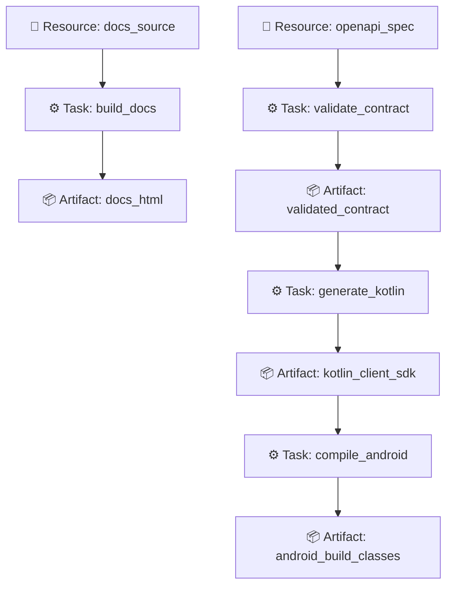

# ONΛJI (同じ)

> **Universal Reactive Build Engine & Causal DAG Scheduler for Polyglot Monorepos**

[](CHANGELOG.md)
[](Cargo.toml)
[](https://www.rust-lang.org)
[](install.sh)

**ONΛJI** (from Japanese *同じ*, "the same") is a high-performance, deterministic task orchestration and caching engine engineered in Rust. It unifies polyglot software repositories (Rust, TypeScript/Node, Kotlin/Gradle, OpenAPI contracts, Python, WASM) through a reactive, content-addressed Directed Acyclic Graph (DAG).

With sub-millisecond graph evaluation, multi-tier Content-Addressed Storage (CAS), sandboxed remote execution, and bidirectional IDE communication, ONΛJI guarantees that you **never rebuild, test, or re-verify the same code twice**.

---

## ⚡ Key Capabilities

### 1. 🔄 Reactive Causal DAG Engine
- **Topologically Sorted Execution**: Automatically resolves causal dependencies among resources, tasks, and artifacts.
- **Smart Change Detection**: Integrates file-system watchers (`notify`) with debounced hash comparison. Only tasks whose direct inputs or upstream artifacts changed are scheduled.
- **Cycle Detection**: Strictly verifies acyclicity during graph building, rejecting circular dependencies at load time.

### 2. 🗄️ Multi-Tier Content-Addressed Storage (CAS)
- **Deterministic Hashing**: Inputs, arguments, and environment configurations resolve to canonical SHA-256 cache keys.
- **Tier 1 (Local CAS)**: Ultra-fast local artifact store with atomic writes and LRU eviction.
- **Tier 2 (Remote CAS)**: Shared team/cluster cache backend, delivering instant cache hits across CI/CD and developer machines.

### 3. 🎯 Smart Test Selection & Git Impact
- **Git Diff Targeting**: Discover exactly what tasks are affected by a git branch or commit range (`onaji affected --since main`).
- **Targeted Test Execution**: Run only test suites directly connected to modified resources in the causal graph (`onaji run --tests`).

### 4. 🌐 Polyglot Adapters & Extensibility
- **Built-in First-Party Adapters**:
  - **OpenAPI**: Contract validation, breaking change detection, and mock servers.
  - **Gradle / Kotlin**: Gradle task inspection, daemon communication, and build outputs.
  - **Rust / Cargo**: Workspace and crate discovery, linting (`clippy`), and compilation.
- **Extensible Plugin Ecosystem**:
  - Sandboxed **WASM Plugins** (`wasmtime`) with strict host capability boundaries.
  - Out-of-process **JSON-RPC Plugins** authored in TypeScript via `@onaji/plugin-sdk`.
  - Pinned dependencies via `onaji.lock` and public registry support (`registry.onaji.dev`).

### 5. 🚀 Distributed Cluster & Remote Execution
- **Worker Daemon**: Distributed execution node with hardware capability matching (OS, Architecture, Toolchains).
- **Work-Stealing Scheduler**: Dynamic aging priority queue, slot-based backpressure, and worker loss recovery.
- **Hardened Sandboxing**: Command injection rejection (no arbitrary subshell chaining), directory traversal containment, and environment scrubbing (`env_clear`).
- **Cluster Security**: Mutual TLS (mTLS) with X.509 certificates and bearer token authorization.

### 6. 📊 Real-Time Web Dashboard & IDE Tooling
- **Embedded Web UI**: Zero-dependency dark-mode visualizer with interactive DAG canvas, worker grid, CAS hit ratios, and live Server-Sent Events (SSE) streaming (`onaji dashboard`).
- **VS Code Extension**: Status bar indicator, interactive DAG tree view, and direct task dispatch (`editors/vscode`).
- **IntelliJ & Android Studio Plugin**: Native tool window and JSON-RPC daemon client (`editors/intellij`).

---

## 🚀 Quickstart (0 to 1 in 3 Minutes)

### Installation

#### Automated Installer (macOS & Linux)
```bash
curl -fsSL https://raw.githubusercontent.com/odiador/onaji/main/install.sh | bash
```

#### Build from Source (Cargo)
```bash
git clone https://github.com/odiador/onaji.git
cd onaji
cargo install --path crates/onaji-cli
```

---

### Step-by-Step Usage

#### 1. Interactive Onboarding
Run onboarding in any existing polyglot repository:
```bash
onaji onboard
```
`onaji onboard` scans your codebase, detects OpenAPI contracts, Cargo crates, Gradle builds, and TypeScript workspaces, checks toolchains via `doctor`, and scaffolds `onaji.yaml`.

#### 2. Verify Graph Integrity
```bash
onaji check
```

#### 3. Execute Incremental Pipeline
```bash
onaji run
```

Subsequent runs without changes will hit Tier 1/Tier 2 Cache instantly:
```bash
onaji run
# ✓ validate_openapi ............. (cached)
# ✓ generate_kotlin_client ....... (cached)
# ✓ compile_android .............. (cached)
```

#### 4. Launch the Visual Dashboard
```bash
onaji dashboard --open
```
Opens the real-time DAG visualizer at `http://127.0.0.1:4040`.

---

## 📄 Configuration Example (`onaji.yaml`)

ONΛJI models your project as **Resources** (inputs/specs), **Artifacts** (produced outputs), and **Tasks** (executable units):

```yaml
version: "1"
name: "polyglot-microservices"

resources:
  openapi_spec:
    type: file
    path: "./backend/api/openapi.yaml"
    debounce_ms: 250
    description: "OpenAPI v3 contract specification"

  docs_source:
    type: file
    path: "./docs"
    debounce_ms: 500
    description: "Markdown documentation source"

artifacts:
  validated_contract:
    description: "Linted OpenAPI schema"

  kotlin_client_sdk:
    description: "Generated Kotlin Multiplatform client SDK"

  android_build_classes:
    description: "Compiled Kotlin Android binaries"

  docs_html:
    description: "Rendered documentation site"

tasks:
  validate_contract:
    description: "Validate OpenAPI contract syntax and breaking changes"
    inputs:
      - openapi_spec
    outputs:
      - validated_contract
    run: "test -f ./backend/api/openapi.yaml && echo 'Contract valid'"

  generate_kotlin:
    description: "Generate Kotlin SDK models and API client"
    inputs:
      - validated_contract
    outputs:
      - kotlin_client_sdk
    run: "./scripts/generate-kotlin-client.sh"

  compile_android:
    description: "Compile and execute Android unit tests"
    inputs:
      - kotlin_client_sdk
    outputs:
      - android_build_classes
    run: "./gradlew :androidApp:assembleDebug"
    timeout_secs: 300      # Kill if hangs past 5 minutes (process deadman switch)
    retries: 2             # Auto-retry on transient flakiness
    cache:
      paths:               # Auto-archived to Content-Addressed Storage (CAS)
        - "build/outputs"

  build_docs:
    description: "Generate static documentation site"
    inputs:
      - docs_source
    outputs:
      - docs_html
    run: "echo 'Building static docs... OK'"
```

### 🛡️ Task Resilience, Security & Physical CAS Storage

- **Causal Failure Isolation vs. Fail-Fast (`--fail-fast`)**: In default mode, an execution failure blocks **only its transitive causal descendants** in the DAG (via BFS traversal), allowing independent tasks (e.g., backend tests vs. frontend lint) to execute concurrently. Supplying `--fail-fast` aborts all pending pipeline waves immediately.
- **Process Deadman Switch (`timeout_secs`)**: Tasks specify maximum runtimes. If a process hangs or asks for interactive input, ONΛJI aborts it with exit code `124` and cleanly kills child processes.
- **Flakiness Recovery (`retries`)**: Configurable exponential retry budget for network/compiler flakiness before flagging pipeline failure.
- **Automatic Content-Addressed Output Restoration**: Outputs declared in `cache.paths` are stored in Tier 1 CAS (`.onaji/cache/cas/<key>/`). If a developer cleans output directories or switches branches, ONΛJI detects missing files on disk and **restores them in 1 ms** without recompilation.
- **Quota-Aware CAS Pruning & Granular Invalidation**: Invalidate individual tasks (`onaji clean --task <task_id>`) with immediate physical CAS reclamation, or enforce disk quotas (`onaji clean --max-size 2GB`) with automated Least-Recently-Used (LRU) artifact tree eviction.
- **Multi-Process Cache Locking**: Cache metadata writes use atomic temporary files protected by an advisory file lock (`.execution_cache.lock`) with automated recovery of orphan locks.
- **Sandboxed Execution & Symlink Escape Prevention**: Hardened command filtering against shell injections and path confinement with canonical resolution preventing symlink sandbox breakouts.
- **Graceful Daemon Shutdown**: `onaji watch` intercepts SIGINT (Ctrl+C), terminates active child processes immediately to prevent zombie processes, and flushes cache state before exiting.

### 🪝 Automated Git Pre-Commit Hook

Install selective pre-commit testing in one command:
```bash
onaji hook install
```
On every `git commit`, ONΛJI executes **only the tests and tasks affected by staged or uncommitted files** via causal graph traversal in sub-15ms. If tests fail, the commit is safely intercepted. Works seamlessly across both terminal CLI and graphical Git clients (VS Code, Fork, GitKraken, Sublime Merge).

### 🧬 Causal DAG Visualization

Rendered dynamically via `onaji graph --format mermaid`:



---

## ⚡ Performance Benchmarks

Micro-benchmarks executed on Apple Silicon (`--release` profile, `opt-level = 3`):

| Target Component | Workload | Throughput | Latency |
|---|---|---|---|
| **DAG Graph Build & Toposort** | 500 tasks + 1,000 dependency edges | ~2,250 DAGs/sec | **443 µs** |
| **Deterministic `CacheKey` (SHA-256)** | 10,000 compound composite keys | **1,190,925 keys/sec** | **0.84 µs / key** |
| **CAS Memory Cache Lookup** | 50,000 concurrent hit queries | **91,095,422 lookups/sec** | **11 nanoseconds** |
| **JSON-RPC Daemon Dispatch** | 1,000 `graph/get` request cycles | **1,244,877 reqs/sec** | **0.80 µs / req** |
| **Content Hashing (`xxHash3`)** | Streaming 64 KB buffers (1,000 MB payload) | **41.08 GB/sec** | - |

---

## 🛠️ CLI Command Reference

| Command | Description |
|---|---|
| `onaji onboard` | Interactive project detection (Rust, Node, Gradle, Go, Python, OpenAPI), diagnostics, and DAG scaffolding |
| `onaji init [--force]` | Auto-detect toolchains and initialize a starter `onaji.yaml` with connected task DAGs |
| `onaji check` | Validate syntax, acyclicity, and dependency graph completeness |
| `onaji run [options]` | Execute affected DAG tasks (`--fail-fast`, `--tests`, `--since <ref>`, `--output json\|github`) |
| `onaji affected [options]` | Discover or execute only tasks affected by git diff changes (`--since <ref>`, `--output json`) |
| `onaji explain <task>` | Print causal explanation, trigger reason, and cache status for a given task |
| `onaji watch [options]` | Run reactive file-watcher daemon with graceful SIGINT shutdown (`--tests`, `--debounce <ms>`) |
| `onaji dashboard [--open]` | Start embedded real-time web UI and dynamic DAG visualizer |
| `onaji doctor` | Run diagnostics on toolchains, container engines (docker/podman), Git hooks, and CAS storage |
| `onaji worker <start\|status>`| Manage worker cluster nodes and remote executors with container sandboxing |
| `onaji security check` | Audit authentication, command sandboxing, and execution policies |
| `onaji workspace <list\|check>`| Multi-workspace monorepo inspection and cross-impact analysis |
| `onaji plugin <list\|add\|...>`| Manage external WASM / JSON-RPC plugins and lockfile |
| `onaji clean [options]` | Invalidate cache records (`--task <id>`), enforce CAS quotas (`--max-size <limit>`), or purge all (`--all`) |
| `onaji hook <install\|uninstall>` | Install or remove automated Git pre-commit hook for selective change testing |
| `onaji completions <shell>` | Generate shell autocomplete scripts (bash, zsh, fish, powershell, elvish) |

---

## 📁 Repository Structure

```
onaji/
├── crates/
│   ├── onaji-core/          # Causal DAG, CAS cache, scheduler, watcher, cluster, adapters
│   ├── onaji-cli/           # Main command-line interface binary (`onaji`)
│   └── onaji-protocol/      # JSON-RPC schemas, DTOs, and protocol specifications
├── packages/
│   ├── create-onaji-plugin/ # Scaffolding CLI for community plugins
│   └── plugin-sdk/          # TypeScript SDK for writing out-of-process JSON-RPC plugins
├── editors/
│   ├── vscode/              # VS Code extension (status bar, graph webview, task runner)
│   └── intellij/            # IntelliJ IDEA & Android Studio plugin
├── backend/
│   └── api/                 # Sample contract definitions (OpenAPI specifications)
├── docs/                    # Architectural guides, concepts, and reference documentation
├── examples/                # Golden path examples (polyglot-workspace, rust-axum-android, etc.)
└── install.sh               # Self-contained installer script for macOS & Linux
```

---

## 🤖 Code Intelligence with CodeGraph

This repository is indexed with **[CodeGraph](https://github.com/codegraph-dev/codegraph)** to provide AI coding assistants (Antigravity IDE, Claude Code, Cursor) with full-graph awareness:

- **Local Index**: Built in `.codegraph/codegraph.db` with SQLite WAL and FTS5 search.
- **Dynamic Dispatch**: Automatically resolves Rust trait implementations (`Adapter`, `CacheBackend`, `ExecutionBackend`) and cross-language boundaries.
- **MCP Integration**: Run `codegraph install` or start `codegraph serve --mcp` to expose symbols, call paths (`codegraph_callers`, `codegraph_callees`), and blast radius impact analysis (`codegraph_impact`) to your AI pair programmer.

---

## 📜 License

ONΛJI is dual-licensed under either:

- **Apache License, Version 2.0** ([LICENSE-APACHE](http://www.apache.org/licenses/LICENSE-2.0))
- **MIT License** ([LICENSE-MIT](http://opensource.org/licenses/MIT))

at your option.
