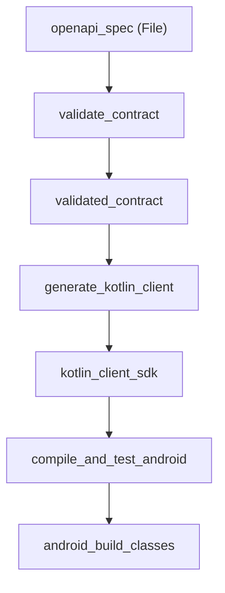

# OpenSpec 06: CLI Capabilities — Doctor & Graph Visualizer

**Status**: Approved  
**Package**: `dev.odiador.onaji.cli`  
**Domain**: Developer Experience, Environment Diagnostics, Visual Introspection  

---

## 1. `onaji doctor`

Comando de diagnóstico de entorno y precondiciones del proyecto:

```bash
$ onaji doctor
```

### Comprobaciones del Sistema:
1. **Toolchain Check**: Presencia y versiones de `cargo`, `rustc`, `node`, `gradle`, `java`, `pnpm`, etc.
2. **Manifest Linting**: Validación de sintaxis en `onaji.yaml` y coherencia de tipos.
3. **Graph Diagnostics**:
   - Comprobación de ciclos en el DAG.
   - Detección de tareas huérfanas (artefactos producidos no consumidos o inputs sin productor).
   - Verificación de rutas de archivos y accesibilidad de endpoints.

---

## 2. `onaji graph`

Comando de introspección visual del Grafo Semántico de Automatización:

```bash
$ onaji graph [--format text|mermaid|json]
```

### Formato Text (Default):
```text
openapi_spec (Resource: File)
   │
   ▼
[Task: validate_contract]
   │ produces
   ▼
validated_contract (Artifact)
   │
   ▼
[Task: generate_kotlin_client]
   │ produces
   ▼
kotlin_client_sdk (Artifact)
   │
   ▼
[Task: compile_and_test_android]
   │ produces
   ▼
android_build_classes (Artifact)
```

### Formato Mermaid (`--format mermaid`):
Permite embeber el flujo en documentación Markdown o renderizarlo en el Webview de VS Code:


